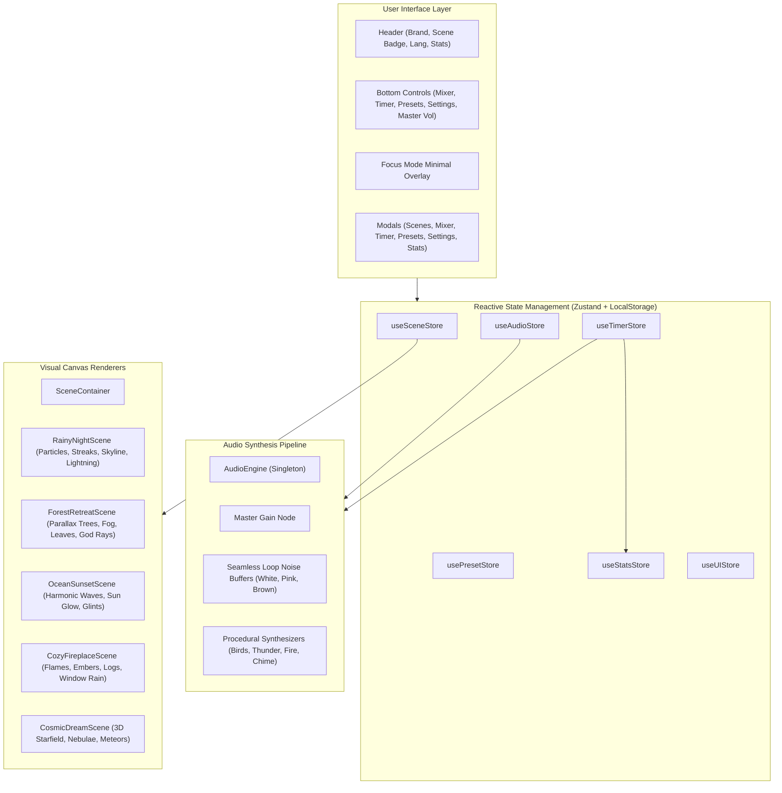

# DreamScape Architecture Documentation

## 1. System Overview

DreamScape is designed as a modular, client-side, zero-latency single-page application (SPA). It pairs high-performance 2D Canvas atmospheric simulations with a procedural Web Audio API audio synthesis pipeline, managed through unidirectional Zustand reactive state stores.

---

## 2. Audio Engineering Principles

### Procedural Sound vs. Heavy External Assets
Rather than downloading multi-megabyte MP3 files that suffer from network latency, 404s, copyright disputes, and loop boundary clicking, DreamScape utilizes Web Audio API procedural synthesis:
1. **Loopable Noise Buffers**: 5-second seamless dual-channel white, pink (Paul Kellet algorithm), and brownian noise buffers generated on initial user interaction.
2. **Frequency Shaping**: Biquad filters (LowPass, HighPass, BandPass, Peaking) isolate acoustic spectral profiles of raindrops, rushing water, and foliage.
3. **LFO Dynamic Modulation**: Swept resonant filters emulate coastal wind howling and tidal ocean wave surges without repetitive loops.
4. **Impulse Synthesizers**:
   - `BirdSongSynthesizer`: Algorithmic FM frequency envelope modulating between 2.4kHz and 4.2kHz with randomized melodic intervals.
   - `ThunderSynthesizer`: Low-frequency exponential boom envelope with steep lowpass filtering (80Hz to 220Hz) and reverberant decay.
   - `FireCrackleSynthesizer`: Highpass filtered sawtooth micro-bursts triggering at 4-10 pops per second to mimic dry pine logs.
   - `playChimeSound`: Crystalline Tibetan singing bowl harmonics (D5, A5, E6, A6) with 3.5s smooth exponential tail.

### Click-Free Gain Automation
Every parameter modification (channel volume, master volume, mute, crossfade) cancels previous scheduled parameter values via `cancelScheduledValues` and transitions via `linearRampToValueAtTime` over a 50-250ms ramp window, eliminating audible digital clipping.

---

## 3. High-Precision Timer Architecture

Standard JavaScript `setInterval` drifts substantially when browser tabs are in the background or during CPU load.
DreamScape solves this via **Timestamp-Based Elapsed Time**:
- Upon starting or resuming: `targetEndTime = Date.now() + durationInSeconds * 1000`.
- On every 250ms tick and on `visibilitychange` events: `remainingSeconds = Math.max(0, Math.ceil((targetEndTime - Date.now()) / 1000))`.
- When `remainingSeconds === 0`, session completion fires cleanly once, triggers the audio chime and system notification, increments session counts, and transitions between Focus and Short/Long Breaks.

---

## 4. Visual Rendering Pipeline

- All five scenes run on isolated `<canvas>` elements managed through standard React lifecycle hooks.
- Automatically adjusts resolution to screen size on resize events.
- Pauses rendering calculations when `document.visibilityState === 'hidden'` to preserve battery and CPU cycles.
- Respects `lowPerformanceMode` by capping particle counts and disabling heavy multi-layer blur passes.
- Scene crossfading is handled through CSS hardware-accelerated opacity transitions (`duration-700 ease-in-out`).
